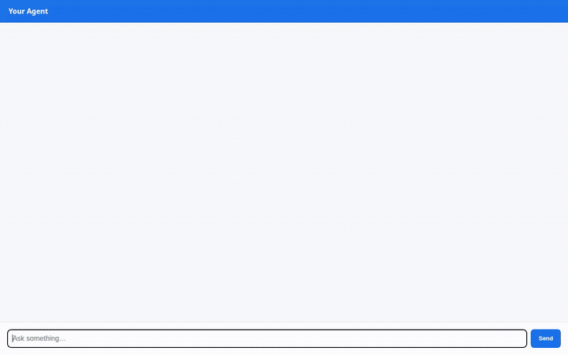

# WanderLust AI ✈️🌍

A conversational travel concierge assistant powered by Google ADK (Agent Development Kit), Gemini 3.6 Flash, and Vertex AI Agent Platform. WanderLust AI helps travelers discover destinations from a curated catalog, plan day-by-day itineraries, generate travel postcards, check live destination weather, calculate multi-currency budgets, and persist plans across sessions with cross-session long-term memory.



---

## What the Agent Does

WanderLust AI pairs conversational intelligence with specialized tools and cloud services:

1. **Curated Destination Search & Details (Google Cloud Firestore):**
   - Queries a curated catalog of global destinations in Firestore (`destinations` collection).
   - Searches by travel style, keywords, tags (e.g. `temples`, `nature`, `culinary`), budget tiers, and max daily budget.
   - Saves travelers' customized trip plans to Firestore (`itineraries` collection).

2. **Rich Visual Cards (A2UI v0.8):**
   - Returns responses using structured [A2UI (Agent-to-User Interface)](https://a2ui.org/) specifications (v0.8).
   - Displays clean cards containing destination overviews, tags, budget tiers, and inline postcard images.

3. **Travel Postcard Image Generation (Vertex AI Imagen + Google Cloud Storage):**
   - Generates scenic travel postcards and moodboards on demand using `gemini-3.1-flash-lite-image` in Vertex AI.
   - Saves generated images to session artifacts and uploads them to a public Google Cloud Storage bucket (`wanderlust-ai-e27338d0990d-assets`), returning public HTTPS URLs rendered directly in A2UI cards.

4. **Long-Term Cross-Session Memory (Vertex AI Memory Bank):**
   - Uses Vertex AI Memory Bank (`VertexAiMemoryBankService`) to recall user preferences across separate conversations (travel pace, favorite destinations, dietary restrictions, and budgets).
   - Automatically preloads user memories at session start and consolidates post-session facts via callbacks.

5. **Live Destination Weather:**
   - Fetches real-time temperatures, weather codes, and wind conditions for any destination using the Open-Meteo API.

6. **Itinerary Planning & Budget Calculation:**
   - Builds day-by-day activity schedules and route suggestions tailored to travelers' desired pace (`relaxed` vs. `balanced`).
   - Computes itemized travel budgets (lodging, dining, activities, transit) with currency conversions across USD, EUR, JPY, GBP, CAD, MXN, and NZD.

7. **Code Execution Sandbox (Agent Platform Sandbox):**
   - Safely executes Python computations in an isolated `AgentEngineSandboxCodeExecutor` environment for complex budget formulas and data operations.

*(Note: Live Google Maps Grounding mentioned in initial exploration was planned but is not yet implemented.)*

---

## Wired Google Cloud Services & Tools

| Service / Tool | Implementation | Purpose |
| :--- | :--- | :--- |
| **Model** | `gemini-3.6-flash` (Vertex AI, `global`) | Core conversational and reasoning agent |
| **Memory Bank** | Vertex AI Memory Bank (`1012357739088707584`) | Long-term memory persistence across sessions |
| **Database** | Google Cloud Firestore | Catalog for destinations and saved traveler itineraries |
| **Object Storage** | Google Cloud Storage (`wanderlust-ai-e27338d0990d-assets`) | Public hosting of generated postcards |
| **Image Generation** | `gemini-3.1-flash-lite-image` | Custom travel postcard image generation |
| **UI Protocol** | A2UI v0.8 (`a2ui_callback` + Basic Catalog) | Rendering visual cards in dev playground and web chat |
| **Code Sandbox** | Vertex AI Agent Engine Sandbox | Isolated Python code execution environment |
| **External API** | Open-Meteo REST API | Live destination weather lookup |

---

## Project Structure

```
wanderlust-ai/
├── app/
│   ├── agent.py               # Root agent definition, system prompts, callbacks, tools
│   ├── a2ui_utils.py          # A2UI v0.8 response reformatter callback
│   ├── fast_api_app.py        # FastAPI server running the ADK agent
│   └── app_utils/
│       └── services.py        # Memory Bank & session service registrations
├── frontend/                  # Lightweight chat web frontend
│   ├── main.py                # FastAPI proxy communicating via A2A protocol
│   ├── static/index.html      # Plain chat UI with native A2UI card renderer
│   ├── Dockerfile             # Container configuration for Cloud Run
│   └── requirements.txt       # Frontend dependencies
├── docs/assets/               # Demo video GIF and documentation assets
├── seed_firestore.py          # Script populating initial Firestore destinations catalog
├── agents-cli-manifest.yaml   # Deployment metadata and configuration
└── pyproject.toml             # Python dependencies and project settings
```

---

## Local Setup & Run

### Prerequisites

- Python 3.11+
- `uv` package manager (`curl -LsSf https://astral.sh/uv/install.sh | sh`)
- `gcloud` CLI authenticated with your GCP project:
  ```bash
  gcloud auth login
  gcloud auth application-default login
  gcloud config set project <YOUR_PROJECT_ID>
  ```

### 1. Install Dependencies & Seed Database

```bash
# In the project root
uv sync

# Populate Firestore destinations catalog (if not already seeded)
uv run python seed_firestore.py
```

### 2. Run Agent Playground (Local ADK Web UI)

To launch the local agent playground with Memory Bank connected:

```bash
export GOOGLE_CLOUD_PROJECT="<YOUR_PROJECT_ID>"
export GOOGLE_CLOUD_LOCATION="us-east1"

uv run adk web . --port 8080 --reload_agents --memory_service_uri=agentengine://<AGENT_ENGINE_ID>
```

### 3. Run Web Chat Frontend Locally

To run the web chat UI connected to your deployed agent:

```bash
cd frontend

uv venv .venv --python 3.11
uv pip install --python .venv -r requirements.txt

export AGENT_ENGINE_RESOURCE_NAME="projects/<PROJECT_NUMBER>/locations/us-east1/reasoningEngines/<AGENT_ENGINE_ID>"
export AGENT_DIRECTORY="app"
export PORT=8080

.venv/bin/python main.py
```

---

## Deployment

### Agent Deployment (Agent Platform)

The agent is packaged and deployed to Vertex AI Agent Runtime via `agents-cli`:

```bash
agents-cli deploy --project <YOUR_PROJECT_ID>
```

### Frontend Deployment (Cloud Run)

The lightweight FastAPI proxy and chat UI can be containerized and deployed to Google Cloud Run:

```bash
cd frontend
gcloud run deploy wanderlust-frontend \
  --source . \
  --region us-east1 \
  --allow-unauthenticated \
  --set-env-vars="AGENT_ENGINE_RESOURCE_NAME=<AGENT_ENGINE_RESOURCE_NAME>,AGENT_DIRECTORY=app"
```

Grant the Cloud Run service account access to invoke the agent:

```bash
gcloud projects add-iam-policy-binding <YOUR_PROJECT_ID> \
  --member="serviceAccount:<COMPUTE_SERVICE_ACCOUNT>" \
  --role="roles/aiplatform.user"
```
